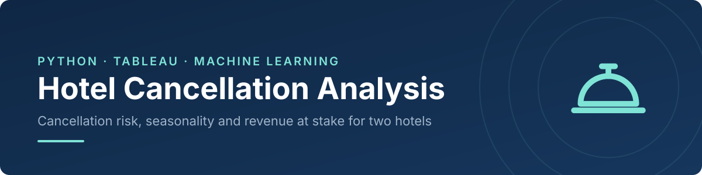
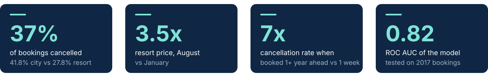
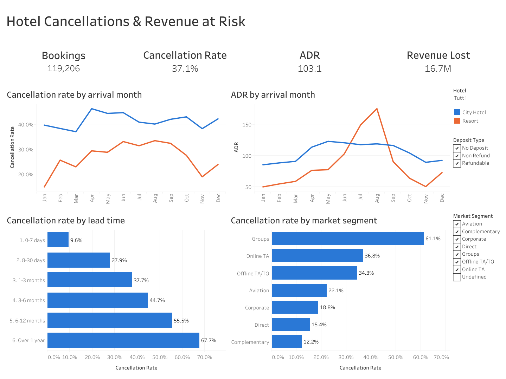
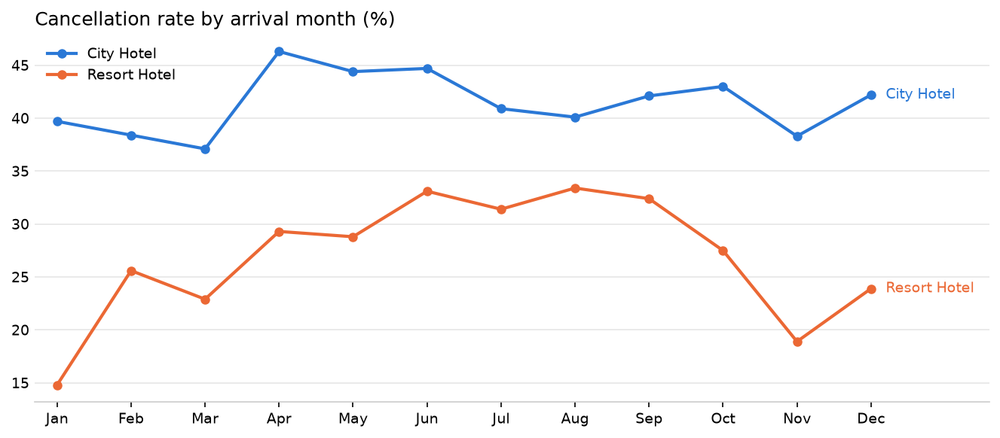
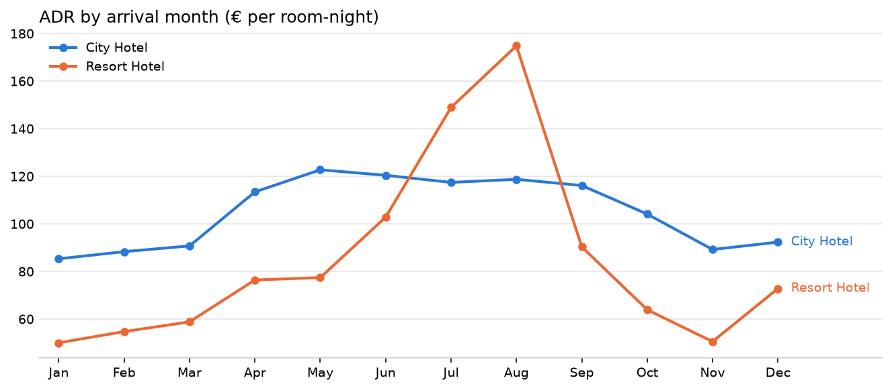
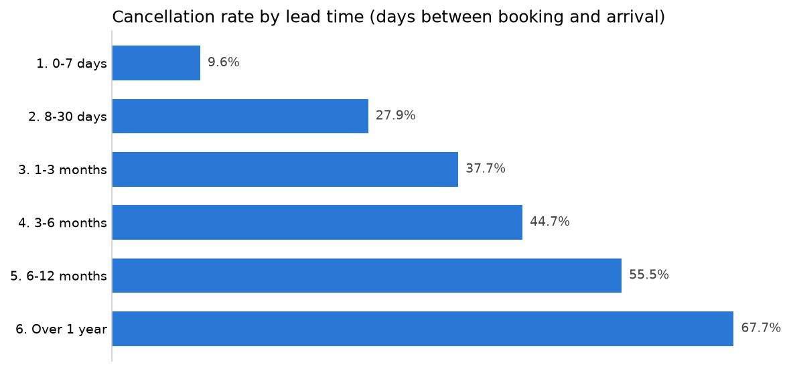
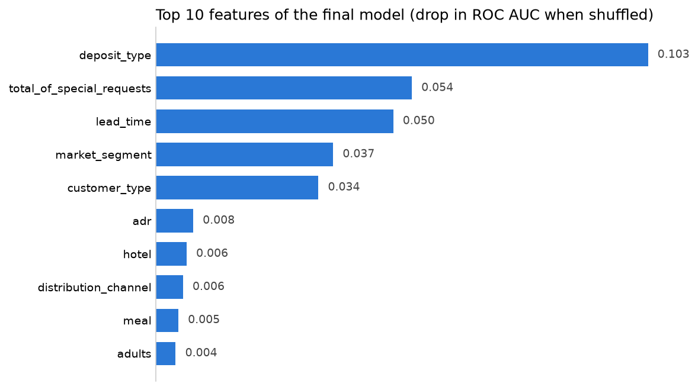
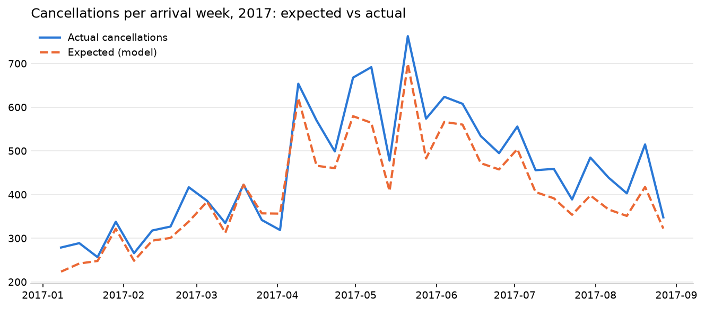
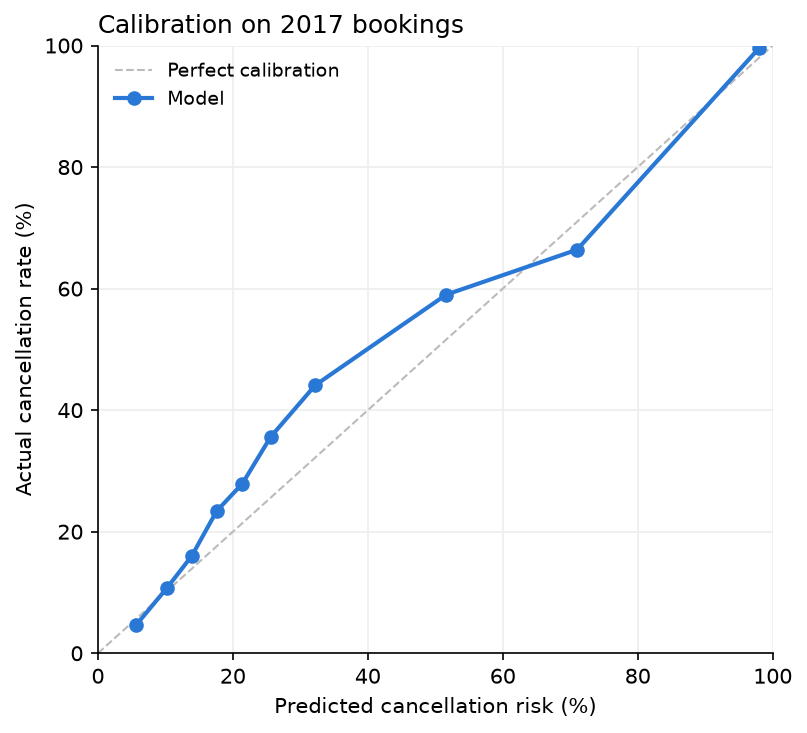

[](images/banner.svg)


[Background](#project-background) · [Key Metrics](#key-metrics) · [Summary](#executive-summary) · [Insights](#insights-deep-dive) · [Recommendations](#recommendations) · [Dashboard](https://public.tableau.com/views/Presentazione_Hotel_Cancellations/Dashboard1) · [Repository](#repository-and-how-to-run)

> Analysis of **119,208 bookings** of a resort and a city hotel. **37%** of bookings are cancelled, cancellations peak in the **most expensive months**, and the risk grows **7x** with lead time. A model tested on 2017 bookings ranks cancellation risk with **ROC AUC 0.82**, turned into risk tiers and weekly forecasts a hotel can act on.

<a id="project-background"></a>
[](images/h_background.svg)

For a hotel, a cancelled booking is a room that may stay empty. Cancellations make it harder to plan staff, set prices and decide how many rooms to overbook. Hotel management software holds the data to see this risk coming: this project shows what a hotel manager could get from it.

Using two years of anonymised bookings from a resort and a city hotel in Portugal, the project answers four questions:

1. How often are bookings cancelled, and how much revenue is at stake?
2. When and why do cancellations happen: season, lead time, segment, deposit?
3. Can the cancellation risk be estimated on the day a booking is made?
4. How can a hotel turn that risk into concrete actions?

An interactive **[Tableau dashboard](https://public.tableau.com/views/HotelCancellationsRevenueatRisk/HotelCancellations)** summarises the KPIs for a hotel manager.

<a id="key-metrics"></a>
[](images/h_metrics.svg)

[](images/kpi_cards.svg)

<a id="executive-summary"></a>
[](images/h_summary.svg)

[](https://public.tableau.com/views/Presentazione_Hotel_Cancellations/Dashboard1)

| Hotel | Bookings | Cancellation rate | Excl. group blocks* | ADR | Revenue of cancelled bookings |
|---|---|---|---|---|---|
| **City Hotel** | 79,162 | **41.8%** | 30.5% | 108.0 | 10.9M |
| Resort Hotel | 40,046 | 27.8% | 24.7% | 97.6 | 5.8M |

*\*Excluding "Non Refund" bookings, almost all tour-operator and group room blocks. ADR = room revenue ÷ room-nights sold. Revenue of cancelled bookings is an upper bound (some rooms are resold, some deposits kept); the currency is not stated in the source (likely EUR).*

**What this means**

- **Cancellations cost most when rooms are most expensive.** Resort prices rise 3.5x from January to August, and so do its cancellations (from 14.8% to 33–34%).
- **The earlier the booking, the higher the risk.** From 9.6% for bookings made within a week of arrival to 67.7% for bookings made over a year ahead.
- **A quarter of the City Hotel's cancellations comes from group blocks,** cancelled 99.4% of the time: group contracts are the first lever.
- **The model concentrates the risk:** the 21% of bookings it rates high-risk are cancelled 81.8% of the time and hold 41% of the revenue lost.
- **Committed guests cancel less:** direct bookings, repeat guests and guests with special requests cancel 2.2–2.6x less.

<a id="insights-deep-dive"></a>
[](images/h_insights.svg)

### 1. Cancellations are highest when rooms are most expensive
[Notebook 02](notebooks/02_hotel_kpis.ipynb)

[](figures/cancel_rate_by_month.png)

[](figures/adr_by_month.png)

The Resort's ADR goes from **50.1 in January to 174.9 in August (3.5x)**, and its cancellation rate from **14.8% to 33–34%** in summer. The City Hotel cancels 37–46% of bookings all year and peaks in spring for both prices and cancellations. In both hotels, revenue at risk is concentrated in peak season.

### 2. Lead time is the strongest single signal
[Notebook 02](notebooks/02_hotel_kpis.ipynb)

[](figures/cancel_by_lead_time.png)

The cancellation rate rises at every step, from **9.6%** (booked within 7 days) to **67.7%** (booked over a year ahead). It also explains the Resort's summer peak, since summer holidays are booked months in advance.

### 3. "Non Refund" bookings are cancelled 99.4% of the time
[Notebook 02](notebooks/02_hotel_kpis.ipynb)

| | "Non Refund" bookings |
|---|---|
| Bookings | 14,586 |
| Cancellation rate | **99.4%** (vs 28.4% with no deposit) |
| Groups or Offline TA/TO | 97% |
| Identical (duplicated) rows | 98.1% |
| City Hotel | 88% |
| Average lead time | 213 days (vs 104 overall) |

Counterintuitive at first: a non-refundable deposit should reduce cancellations. These are almost all **tour-operator and group room blocks** booked months ahead and released when unsold; the label most likely reflects the contract terms of the block, or a coding issue in the source. Excluding them, the City Hotel's cancellation rate drops from 41.8% to 30.5%.

### 4. Committed guests cancel less
[Notebook 02](notebooks/02_hotel_kpis.ipynb)

| Signal | Cancellation rate |
|---|---|
| Direct booking vs online travel agency | **15.4%** vs 36.8% |
| Repeat guest vs new guest | **14.7%** vs 37.8% |
| At least one special request vs none | **~22%** vs 47.8% |
| Groups segment | 61.1% |

### 5. A model that ranks cancellation risk, without leakage
[Notebook 03](notebooks/03_cancellation_model.ipynb)

[](figures/feature_importance.png)

| Model (tested on 2017 arrivals) | Accuracy | Precision | Recall | ROC AUC |
|---|---|---|---|---|
| *Always "not cancelled"* | *61.3%* | *—* | *0%* | *—* |
| *Rule: lead time > 90 days or Non Refund* | *63.1%* | *51.8%* | *66.9%* | *—* |
| Logistic regression | 76.3% | 80.4% | 51.5% | 0.839 |
| Random forest (all features) | 76.8% | 79.5% | 54.2% | 0.846 |
| **Random forest without `country` (final)** | **76.1%** | **78.4%** | **52.9%** | **0.824** |

*Threshold 0.5. Precision: share of flagged bookings that are really cancelled. Recall: share of cancellations that are flagged.*

The model flags cancellations with ~80% precision vs 52% for a simple rule. `country` was the top feature (guests from Portugal cancel 56.7% vs 17–35% for other countries), but nationality may be recorded at check-in, so the final model excludes it: **a slightly weaker model that can be trusted**. Its top features are the same signals found in the analysis: deposit type, special requests, lead time, market segment and customer type.

### 6. From risk scores to decisions
[Notebook 04](notebooks/04_business_impact.ipynb)

[](figures/expected_vs_actual_weekly.png)

| Risk tier | Share of bookings | Cancellation rate | Share of revenue lost | Action |
|---|---|---|---|---|
| Low (< 30%) | 62.7% | 20.7% | 32.9% | No action |
| Medium (30–60%) | 16.1% | 52.1% | 26.2% | Reminder email with easy reconfirmation |
| **High (≥ 60%)** | **21.3%** | **81.8%** | **41.0%** | Reconfirmation call, deposit request, overbooking |

*2017 test bookings (40,619). Share of revenue lost = share of the revenue of all cancelled bookings.*

**One booking in five holds 41% of the revenue lost:** high-risk bookings are cancelled 81.8% of the time. If early action on them allowed the hotels to resell 10–30% of those rooms, **0.3–0.9M** of revenue could be recovered over January–August 2017 (a scenario, not a measured result). Low-risk bookings still cancel 20.7% of the time: the model reduces uncertainty, it does not remove it.

Summing the risk of all bookings arriving in a week gives the expected number of cancellations. Over 34 weeks of 2017 the forecast follows the actual pattern with an **average weekly error of 11.0%**, but it **underestimates the total by ~10%** (13,905 expected vs 15,505 actual): 2017 bookings were cancelled more often than in the training years (38.7% vs 36.2%). Before using it for overbooking, the model should be recalibrated regularly on the most recent bookings.

[](figures/calibration.png)

**Technical details**

```
raw bookings ──► cleaning & checks ──► KPIs & seasonality ──► model (train 2015–16, test 2017) ──► risk tiers & forecasts
 (119,390)        (notebook 01)          (notebook 02)            (notebook 03)                      (notebook 04)
                         │
                         └──► clean CSV ──► Tableau dashboard
```

- **Duplicates kept on purpose:** 26.8% of rows are identical, mostly group room blocks cancelled 58.4% of the time (vs 26.2%). The data has no booking ID, so they are likely separate rooms; dropping them would cut the cancellation rate from 37.0% to 27.5% and hide the largest cancellations. They are flagged with `is_duplicate`.
- **Impossible values removed:** 180 bookings with no guests, 1 negative and 1 extreme `adr` (5,400). Free stays (`adr` = 0) are kept but excluded from ADR.
- **Data leakage:** `reservation_status` (maps 1:1 to the outcome), `reservation_status_date`, `assigned_room_type`, `booking_changes` and `required_car_parking_spaces` (0.0% cancellation when a space is recorded) are only known after booking and are excluded. `country` is excluded from the final model for the same reason.
- **Time-based validation:** trained on 2015–2016 arrivals (78,589), tested on 2017 arrivals (40,619), as the model would be used in practice.
- **Baselines first:** the model is compared with "always not cancelled" and a simple business rule.
- **Calibration and aggregate forecasts:** the model is evaluated as a decision tool, not only on accuracy.

<a id="recommendations"></a>
[](images/h_reco.svg)

1. **Act on risk tiers, not on single predictions.** Reminder emails for medium-risk bookings; reconfirmation calls, deposit requests and overbooking only for high-risk ones, where the model is most precise. Never cancel or reject a booking based on the score alone.
2. **Plan overbooking on expected cancellations per date, recalibrated on recent bookings,** with extra attention to long-lead bookings and peak-season dates, when cancellations cost most.
3. **Renegotiate group and tour-operator blocks.** They account for about a quarter of the City Hotel's cancellations: earlier release dates, smaller blocks or clearer penalties.
4. **Grow committed bookings.** Direct bookings and repeat guests cancel 2.4–2.6x less: loyalty programmes and direct-booking incentives also reduce cancellation risk.

**Limitations:** two hotels in Portugal only; anonymised data without booking IDs or market prices; the test period covers January–August 2017; revenue of cancelled bookings is an upper bound; the value of early action depends on assumptions (scenarios in notebook 04).

<a id="repository-and-how-to-run"></a>
[](images/h_repo.svg)

```
Hotel_Cancellation_Analysis/
├── data/
│   ├── raw/                          # hotel_bookings.csv from Kaggle (not in the repo)
│   └── processed/                    # clean data and model predictions (created by the notebooks)
├── notebooks/
│   ├── 01_data_cleaning.ipynb        # quality checks and cleaning decisions
│   ├── 02_hotel_kpis.ipynb           # KPIs, seasonality and cancellation drivers
│   ├── 03_cancellation_model.ipynb   # leakage checks, baselines and models
│   └── 04_business_impact.ipynb      # calibration, thresholds, risk tiers, forecasts
├── figures/                          # charts exported by the notebooks
├── images/                           # README banners
├── requirements.txt
└── README.md
```

```bash
git clone https://github.com/AlessandroCucchi/Hotel_Cancellation_Analysis.git
cd Hotel_Cancellation_Analysis
python -m venv .venv
source .venv/bin/activate          # Windows: .venv\Scripts\activate
pip install -r requirements.txt
# download hotel_bookings.csv into data/raw/
jupyter notebook                    # run notebooks 01 to 04 in order
```

**Data:** [Hotel Booking Demand](https://www.kaggle.com/datasets/jessemostipak/hotel-booking-demand), from Antonio, Almeida & Nunes (2019), *Hotel booking demand datasets*, Data in Brief. 119,390 bookings of a resort and a city hotel in Portugal, arrivals from July 2015 to August 2017. Please check the source's terms of use before reusing the data.

**Dashboard:** [Hotel Cancellations & Revenue at Risk](https://public.tableau.com/views/Presentazione_Hotel_Cancellations/Dashboard1) (Tableau Public). 2 bookings with an undefined market segment are excluded from the dashboard.

## Author

**Alessandro Cucchi**

[](www.linkedin.com/in/alessandrocucchi-)
[](https://github.com/AlessandroCucchi)
